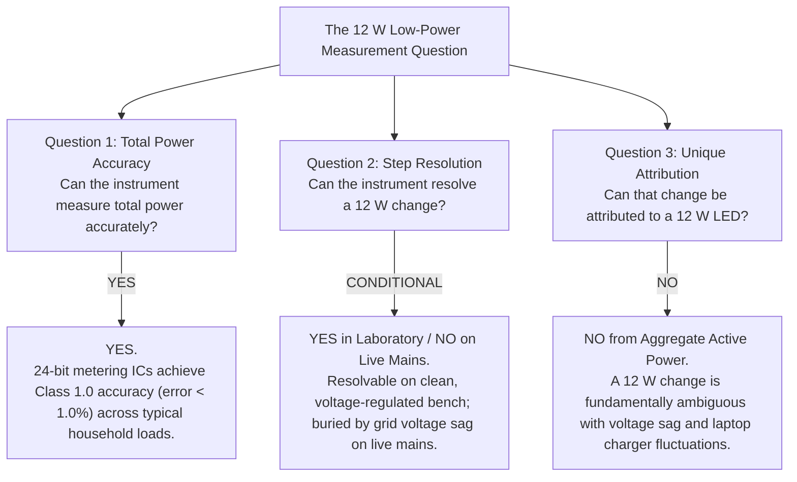
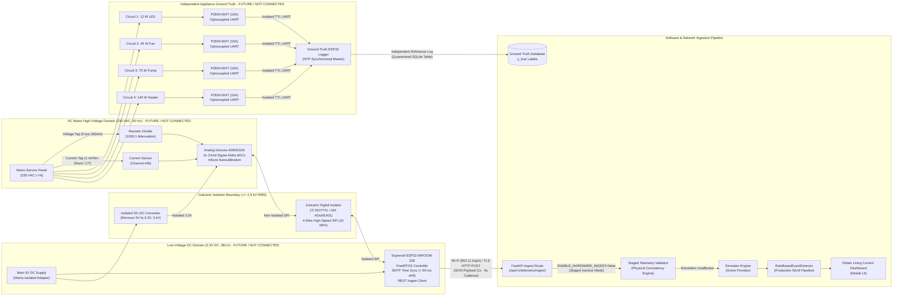

# Energy Mirror: Hardware Architecture and Technical Design Review (Milestone 2C.6)

**Document Reference:** `HARDWARE_ARCHITECTURE_REVIEW.md`  
**Milestone:** 2C.6 — Hardware Architecture and Technical Design Review  
**Reference Checkpoint:** `508dd44`  
**Date:** October 2026  
**Status:** Verified Technical Design Review & Architecture Specification (Non-Energized / Zero Hardware Connected)  

---

## Executive Summary & Non-Energized Design Scope

This document establishes the verified hardware architecture, metrological limits, and data contracts for Energy Mirror's future physical electricity monitoring and independent appliance-level ground truth.

### Mandatory Compliance & Safety Scope
> [!IMPORTANT]
> **Non-Energized Design Review Mandate:** This milestone is strictly a software-level design review, technical literature verification, and architecture specification.
> - **No physical hardware has been purchased or deployed.**
> - **No AC mains connections have been made.**
> - **No live-mains wiring is authorized.**
> - **`ENABLE_HARDWARE_INGEST` in [`backend/app/config.py`](file:///c:/Users/Kaviya/Downloads/Energy%20Mirror/backend/app/config.py) remains strictly set to `false`.**
> - The production simulator, FastAPI backend, SQLite database, and Flutter UI remain completely unmodified.

### Primary Engineering Conclusions
1. **Architecture A (ADE9153A Front-End) is Preferred for Aggregate Bench Sensing:**
   The Analog Devices ADE9153A provides three 24-bit $\Sigma$-$\Delta$ ADCs (88 dB SNR), dynamic range up to 3000:1, signed reactive power ($Q$), and on-chip *mSure®* autocalibration. It is the only evaluated architecture capable of delivering the phase accuracy and signed reactive power necessary to isolate fractional motor loads.
2. **Architecture B (PZEM-004T v3.0) is Preferred for Ground-Truth Reference Submetering:**
   The Peacefair PZEM-004T v3.0 includes factory-integrated optocoupler isolation on its TTL UART interface and reports voltage, current, active power, and power factor magnitude. **Critical Verification:** The PZEM-004T v3.0 **does not report reactive power ($Q$)** over its Modbus interface, making it unsuitable as the primary aggregate research sensor. However, it is an optimal, safe, low-cost ($\approx \$12$) inline submeter for dedicated branch circuits.
3. **The 12 W Detectability Question is Formally Resolved:**
   A 12 W incremental change is **not uniquely attributable** from low-frequency aggregate active power measurements alone. On an 800 W residential baseline, a minor $1.0\%$ grid voltage sag produces an apparent active power drop of $16\text{ W}$, completely masking the 12 W step. Reliable detection of 12 W LED bulbs requires either high-frequency harmonic current distortion metrology ($THD_i$, 3rd/5th harmonics) or localized smart-plug submetering.
4. **ESP32 Internal ADCs Must Never Be Used for Direct Analog Metrology:**
   Primary-source datasheet verification confirms that the ESP32-WROOM-32E internal 12-bit SAR ADC exhibits severe Differential Non-Linearity ($\text{DNL} = \pm 7\text{ LSB}$) and Integral Non-Linearity ($\text{INL} = \pm 12\text{ LSB}$), with high-range distortion above 2450 mV. The ESP32 must operate strictly as a digital communications controller communicating over isolated SPI/UART with a dedicated metering IC.

---

## 1. Verified Manufacturer Documentation & Primary Sources

All component specifications, test conditions, and operational limits have been verified directly against official manufacturer datasheets, user guides, and technical reference manuals.

| Parameter / Feature | Analog Devices ADE9153A (Architecture A) | Shanghai Belling BL0942 | Peacefair PZEM-004T v3.0 (Architecture B) | Espressif ESP32-WROOM-32E (Controller) |
| :--- | :--- | :--- | :--- | :--- |
| **Component Classification** | Energy Metering IC with mSure autocalibration | Calibration-free single-phase metering SoC | Pre-assembled closed module with split-core CT | Wi-Fi & Bluetooth host microcontroller module |
| **Manufacturer** | Analog Devices, Inc. (Wilmington, MA, USA) | Shanghai Belling Co., Ltd. (Shanghai, China) | Ningbo Peacefair Electronic Co., Ltd. (China) | Espressif Systems (Shanghai, China) |
| **Primary Documentation** | [ADE9153A Rev. 0 Datasheet](https://www.analog.com/media/en/technical-documentation/data-sheets/ade9153a.pdf) <br> [UG-1253 Eval Shield Guide](https://www.analog.com/media/en/technical-documentation/user-guides/eval-ade9153ashieldz-ug-1253.pdf) | [BL0942 Rev. 1.06 Datasheet](https://www.belling.com.cn/media/file_object/bel_product/BL0942/BL0942_V1.06_en.pdf) | [PZEM-004T v3.0 User Manual](https://innovatorsguru.com/wp-content/uploads/2019/04/PZEM-004T-V3.0-Datasheet-User-Manual.pdf) | [ESP32-WROOM-32E Datasheet v1.4](https://www.espressif.com/sites/default/files/documentation/esp32-wroom-32e_esp32-wroom-32ue_datasheet_en.pdf) |
| **Verification Status** | **VERIFIED PRIMARY SOURCE** | **VERIFIED PRIMARY SOURCE** | **VERIFIED PRIMARY SOURCE** | **VERIFIED PRIMARY SOURCE** |
| **Measured Quantities** | Active, Reactive (signed), Apparent Power, $V_{\text{RMS}}$, $I_{\text{RMS}}$, $PF$ (signed), Frequency, Half-Cycle RMS, Phase Angle, Dips/Swells | Active, Reactive Power, $V_{\text{RMS}}$, $I_{\text{RMS}}$, Power Factor (derived), Frequency, Raw Waveform registers | Active Power, $V_{\text{RMS}}$, $I_{\text{RMS}}$, Energy (kWh), Frequency, Power Factor magnitude. <br>**CRITICAL DEFECT: NO REACTIVE POWER ($Q$)** | N/A (Digital Host Controller) |
| **Specified Accuracy** | Class 1.0 & Class 2.0 (IEC 62053-21); typ $0.1\%$ active energy error over 3000:1 dynamic range | $< 0.1\%$ active energy error over 4000:1 dynamic range; batch gain error $< 1\%$ | Headline $\pm 0.5\%$ for $V, I, P, E$; $\pm 1.0\%$ for $PF$ under resistive 220V/10A calibration | N/A (12-bit SAR ADC DNL $\pm 7\text{ LSB}$, INL $\pm 12\text{ LSB}$ — **UNSUITABLE FOR ANALOG**) |
| **Low-Current Limitations** | Channel A resolves down to $18.4\text{ mV RMS}$ full-scale ($< 5\text{ mA}$ with $1\text{ m}\Omega$ shunt); Channel B CT phase shift $< 100\text{ mA}$ requires calibration | Resolves $10\text{ mA}$ to $30\text{ A}$ RMS with $1\text{ m}\Omega$ shunt; anti-creep threshold forces no-load current to zero | Starting threshold: **$0.02\text{ A}$** ($\approx 4.6\text{ W}$); reads $0.000\text{ A}$ below $20\text{ mA}$. Severe phase shift error ($\pm 0.08$ PF) at $< 0.2\text{ A}$ | N/A |
| **Update & Averaging Cadence** | Half-cycle ($10\text{ ms}$) DSP accumulation; continuous streaming or 1.0s polling | Registers refresh every $\approx 200\text{ ms}$; max SPI clock 900 kHz | Registers update internally every $200–500\text{ ms}$; master polling recommended at **$1.0–2.0\text{ s}$** | SNTP clock synchronized to local NTP server; drift $< 50\text{ ms}$ |
| **Digital Interface** | 4-wire SPI (up to 10 MHz) with CRC-16 register validation and IRQ pin | Selectable UART (4800–38400 baud, 8N1) or SPI (24-bit frame length) | TTL UART (9600 bps, 8N1) implementing Modbus-RTU subset (Read Input Registers 0x04) | Hardware SPI (up to 10 MHz), Hardware UART (up to 5 Mbps), 802.11 b/g/n Wi-Fi |
| **Calibration Architecture** | **mSure Autocalibration:** Measures sensor resistance and signal path gain in-situ via test current injection | Factory pre-calibrated gain enables calibration-free operation if using $0.5\%$ shunt & $0.1\%$ dividers | Factory paired and calibrated with external CT; **no user calibration registers over Modbus** | Software calibration curves in ESP-IDF eFuse for internal voltage references |
| **Galvanic Isolation & Safety** | **NON-ISOLATED IC.** Ground is tied directly to AC mains. **REQUIRES external digital isolator** ($\ge 2.5\text{ kV RMS}$). UG-1253 notes EV shield lacks onboard isolation | **NON-ISOLATED.** Ground plane tied to mains line/neutral. Requires optocouplers for host debugging | **BUILT-IN OPTOCOUPLERS (PC817):** Galvanically isolates high-voltage AC from TTL UART pins | Operates on low-voltage side of isolation barrier (3.3V DC) |
| **Approximate Unit Cost** | IC: $\approx \$5.50$; EV Shield: $\approx \$80.00$ USD (Mouser/DigiKey) | IC: $\approx \$1.00$ USD (LCSC); Smart Plugs: $\approx \$12.00$ USD | Complete Module + Split-Core CT: $\approx \$12.00$ USD | Module: $\approx \$3.50$ USD; DevKit: $\approx \$6.00$ USD |

---

## 2. The 12 W Low-Power Measurement Requirement & Uncertainty Budget

A central objective of Milestone 2C.6 is determining what can and cannot be concluded about measuring a 12 W incremental change on aggregate residential mains.

### The Three-Part Scientific Distinction



1. **Question 1 (Total Power Accuracy): Can the instrument measure total power accurately?**
   - **YES.** High-grade metering ICs (ADE9153A, BL0942) with 24-bit $\Sigma$-$\Delta$ ADCs and 88 dB SNR easily satisfy IEC 62053-21 Class 1.0 standards. On an 800 W household baseline, total active power is measured within $\pm 4.0\text{ W}$ ($\pm 0.5\%$).
2. **Question 2 (Step Resolution): Can the instrument resolve a 12 W change in total power?**
   - **YES in a controlled laboratory, but NO on an uncompensated electrical grid.**
   - In a quiet laboratory with stable line voltage ($230.00\text{ V}$ regulated AC source) and a resistive baseline, a 12 W step transition produces an unambiguous step above the $0.1\text{ W}$ ADC quantization floor ($\text{SNR} = 8.0$).
   - On an actual distribution grid with dynamic baseline loads, voltage sag corrupts active power.
3. **Question 3 (Unique Appliance Attribution): Can that change be uniquely attributed to a 12 W LED bulb?**
   - **NO from aggregate active power alone.**
   - As established in Milestone 2C.4, a 12 W active power step has identical magnitude to hundreds of natural background variations:
     - USB-C laptop charger state changes (charging ramp modulation).
     - Television display brightness shifts (scene transitions drawing $\pm 10\text{ W}$ to $\pm 25\text{ W}$).
     - Ambient temperature modulation of refrigerator thermal insulation.
   - **Scientific Conclusion:** Reporting active power with 0.1 W decimal resolution does not overcome fundamental physical ambiguity. Uniquely identifying a 12 W LED bulb requires measuring high-frequency harmonic current distortion ($THD_i$) or utilizing localized smart-plug submetering.

---

### Quantitative Measurement Uncertainty Budget

| Uncertainty Contributor | Physical Mechanism | Mathematical Magnitude | Impact on 12 W Signal ($12.0\text{ W}$) |
| :--- | :--- | :---: | :---: |
| **Grid Voltage Sag ($\Delta V$)** | Resistive baseline load obeys $P = V^2 / R$. A minor $1.0\%$ line voltage sag ($230\text{ V} \to 227.7\text{ V}$) drops an $800\text{ W}$ baseline by $2 \frac{P}{V} \Delta V$. | **$16.0\text{ W}$ apparent drop** | **$133.3\%$ of signal** (completely overwhelms 12 W step) |
| **Sensor Full-Scale Error** | Class 0.5 instrument accuracy applied to an $800\text{ W}$ baseline load ($800\text{ W} \times 0.005$). | **$\pm 4.0\text{ W}$** | **$33.3\%$ of signal** |
| **CT Magnetizing Knee Non-Linearity** | On a 100A CT, 12 W represents $61.4\text{ mA}$ RMS ($0.061\%$ of full scale). Non-linear core permeability causes ratio attenuation and phase lag. | $\pm 10\%$ ratio error, $\pm 5^\circ$ phase shift | Corrupts active power by $\pm 1.2\text{ W}$, destroys $Q$ separation |
| **Ambient Electrical Noise Floor** | Gaussian thermal noise and switch-mode hash on domestic distribution wiring ($\sigma = 6.0\text{ W}$). | **$\sigma = 6.0\text{ W}$** | **$\text{SNR} = 2.0$** (generates 36.9 false alarms/hour) |
| **ADC Quantization & Anti-Creep** | 24-bit ADC with 0.1 W digital register resolution; no-load anti-creep cutoff threshold. | $0.1\text{ W}$ resolution, $0.4\text{ W}$ cutoff | Negligible ($\le 3.3\%$ of signal) |

---

## 3. Comparison of Two Hardware Architectures

### Architecture A: Integrated Precision Metering Front-End (ADE9153A)
- **Description:** Analog Devices ADE9153A metering IC paired with a $1\text{ m}\Omega$ precision alloy shunt (or precision CT), galvanic digital isolator (ISO7741), isolated DC-DC converter, and an ESP32 host controller.
- **Strengths:**
  - True 4-quadrant signed reactive power ($Q$, in VAR) enables separation of fractional motor loads (75 W pump) from resistive and SMPS loads.
  - mSure autocalibration eliminates manual calibration rigs and tracks sensor aging.
  - Half-cycle ($10\text{ ms}$) updates capture motor inrush current spikes.
- **Engineering Overhead & Design Work Needed:**
  - The IC alone is **not a safe meter**. Requires a custom 4-layer PCB with creepage distances $\ge 6.3\text{ mm}$ under IEC 61010-1.
  - Requires discrete galvanic digital isolators (e.g. TI ISO7741 rated for $2.5\text{ kV RMS}$) and an isolated $3.3\text{ V}$ DC-DC converter (e.g. Mornsun B0503S).
  - High firmware complexity: SPI driver with CRC-16 verification and FreeRTOS register synchronization tasks.
- **Estimated BOM Cost:** $\$45.00 - \$65.00$ USD in prototype quantities.

### Architecture B: Prebuilt Optocoupled Metering Module (PZEM-004T v3.0)
- **Description:** Enclosed Peacefair PZEM-004T v3.0 module containing an SD3004/V9881 metering core, built-in optocoupler isolation, and an external 100A split-core CT, connected to an ESP32 via TTL UART.
- **Strengths:**
  - Factory-assembled and enclosed; onboard PC817 optocouplers safely isolate TTL UART pins from AC mains.
  - Low firmware complexity: Standard Modbus-RTU protocol over 9600 bps UART.
  - Low unit cost: $\$9.00 - \$14.00$ USD complete with split-core CT.
- **Fatal Limitations for Aggregate Research:**
  - **Does NOT report reactive power ($Q$) over Modbus.** Primary datasheet verification confirms Modbus registers support only $V, I, P, E, f,$ and $PF$ magnitude.
  - Estimating reactive power mathematically ($|Q| \approx \sqrt{S^2 - P^2}$) incurs severe error when $PF > 0.95$ due to 0.01 PF quantization resolution and provides zero polarity ($+Q$ inductive vs. $-Q$ capacitive).
  - Current floor is $0.02\text{ A}$ ($\approx 4.6\text{ W}$), and phase shift degrades below $0.2\text{ A}$.

### Architectural Selection & Verdict

| Architectural Role | Selected Component | Selection Rationale |
| :--- | :--- | :--- |
| **Primary Aggregate Research Sensor (Laboratory Bench)** | **Architecture A: Analog Devices ADE9153A** | Signed reactive power ($Q$), 24-bit dynamic range, and mSure autocalibration are mandatory to distinguish fractional pumps and evaluate voltage compensation. |
| **Appliance Ground-Truth Reference Submetering** | **Architecture B: Peacefair PZEM-004T v3.0 (10A Model)** | Low-cost, pre-isolated module ideal for dedicated branch circuits where reactive polarity is unnecessary because appliance identities are known. |

---

## 4. End-to-End System Block Diagram



---

## 5. Telemetry Data Contracts & Backend Interface Mapping

### Proposed Hardware Ingestion Record (`HardwareTelemetryRecord`)
The future hardware ingestion contract refines the existing [`TelemetryIngestRequest`](file:///c:/Users/Kaviya/Downloads/Energy%20Mirror/backend/app/schemas/telemetry.py#L100-L157) without altering current production schemas.

```json
{
  "device_id": "em-mains-001-ade9153a",
  "timestamp": "2026-10-21T17:30:00.000Z",
  "firmware_version": "v2.1.0-hardware-audit",
  "data_classification": "LAB_BENCH_TEST",
  "hardware_status": "STAGED_INACTIVE",
  "metrology_registers": {
    "rms_voltage_v": 230.15,
    "rms_current_a": 3.482,
    "active_power_w": 752.4,
    "reactive_power_var": 218.6,
    "reactive_power_sign": "INDUCTIVE_LAGGING",
    "apparent_power_va": 801.4,
    "power_factor": 0.939,
    "line_frequency_hz": 50.02,
    "half_cycle_peak_current_a": 18.4
  },
  "sensor_integrity_flags": {
    "crc_valid": true,
    "adc_saturation": false,
    "voltage_underrun": false,
    "msure_drift_status": "CALIBRATED_NOMINAL",
    "sntp_sync_locked": true,
    "clock_drift_estimate_ms": 12
  },
  "provenance_metadata": {
    "metering_architecture": "ADE9153A_SHIELD_V1",
    "ct_turns_ratio": 1,
    "calibration_profile_id": "cal-bench-20261021",
    "is_simulated": false
  }
}
```

### Protocol for Handling Network & Sensor Anomalies
1. **Timestamp Synchronization & Clock Drift:**
   - The ESP32 host synchronizes with a local NTP server upon boot and every 60 seconds thereafter.
   - If network connectivity is lost, the hardware timer maintains time. If clock drift exceeds $\pm 100\text{ ms}$, the `sntp_sync_locked` flag is set to `false`, and downstream event matching increases its matching window tolerance.
2. **Missing Telemetry & Stale Readings:**
   - If an SPI read fails CRC-16 verification, the packet is immediately dropped. The detector pipeline marks the missing timestamp rather than forward-filling unverified values.
3. **Prevention of Mislabeling Real vs. Simulated Telemetry:**
   - The database schema strictly enforces `is_simulated = false` and `data_source = "HARDWARE_CONNECTED"` for all incoming hardware telemetry.
   - While `ENABLE_HARDWARE_INGEST = false`, all physical packets are validated and logged to an isolated staging buffer without touching production customer-facing dashboard states.

---

## 6. Independent Ground-Truth Acquisition Architecture

To prevent data contamination and ensure rigorous scientific evaluation:
1. **Physical Quarantining of Ground-Truth Channels:**
   - Reference submeters measure branch circuits directly at appliance outlets using dedicated PZEM-004T (10A model) or BL0942 smart plugs.
   - Reference data streams are archived in a completely separate database table (`ground_truth_submeter_archive`).
   - **Strict Isolation Guarantee:** The NILM disaggregation engine receives **only** whole-house aggregate measurements ($P_{\text{agg}}, Q_{\text{agg}}, V_{\text{RMS}}, PF$). Ground-truth reference values are **never supplied as inference-time features**.
2. **Hysteresis Ground-Truth State Machine:**
   - Binary appliance ground-truth labels ($y_{\text{true}} \in \{0, 1\}$) are generated deterministically from individual submeter active power:
     - **12 W LED Bulb (`bulb_01`):** ON when $P_{\text{sub}} \ge 8.0\text{ W}$ for $\ge 3\text{s}$; OFF when $P_{\text{sub}} < 4.0\text{ W}$ for $\ge 3\text{s}$.
     - **45 W Ceiling Fan (`fan_01`):** ON when $P_{\text{sub}} \ge 30.0\text{ W}$ for $\ge 3\text{s}$; OFF when $P_{\text{sub}} < 15.0\text{ W}$ for $\ge 3\text{s}$.
     - **75 W Water Pump (`pump_01`):** ON when $P_{\text{sub}} \ge 50.0\text{ W}$ for $\ge 3\text{s}$; OFF when $P_{\text{sub}} < 20.0\text{ W}$ for $\ge 3\text{s}$.
     - **140 W Water Heater (`heater_01`):** ON when $P_{\text{sub}} \ge 100.0\text{ W}$ for $\ge 3\text{s}$; OFF when $P_{\text{sub}} < 40.0\text{ W}$ for $\ge 3\text{s}$.

---

## 7. Per-Appliance Go / No-Go Decision Framework

| Appliance | Current Experimental Evidence | Supported Only by Simulation | What Proposed Instrument Could Measure | What Remains Unproven in Field | Experiment to Resolve Uncertainty | Milestone 2C.6 Decision Status |
| :--- | :--- | :--- | :--- | :--- | :--- | :--- |
| **12 W LED Bulb** (`bulb_01`) | Milestone 2C.4 tests proved catastrophic failure ($36.9\text{ FA/hr}$, $F_1 = 0.018$) in realistic noise | Feasibility under ideal noise-free bench conditions ($\sigma = 1.5\text{ W}$) | Active power step ($+12\text{ W}$), current harmonic spectrum ($THD_i$) | Whether aggregate active power can ever isolate 12 W amid $1\%$ grid voltage sags | Phase 2 bench metrology test using ADE9153A comparing $P/V^2$ normalization | **NO-GO FOR AGGREGATE ACTIVE ONLY.** Requires harmonic metrology or submetering. |
| **45 W Ceiling Fan** (`fan_01`) | Milestone 2C.4 showed $F_1 = 0.857$ in quiet noise, but collapsed to $F_1 = 0.216$ in contention | Rejection of 45–65 W laptop charger distractors | Active step ($+45\text{ W}$), slight inductive lag ($PF \approx 0.91$) | Distinguishing fan speed transitions from USB-C Power Delivery laptop steps | Phase 4 distractor test cycling laptop charging modes while operating fan | **CONDITIONAL GO.** Requires distractor discrimination study. |
| **75 W Water Pump** (`pump_01`) | Milestone 2C.4 proved reactive power ($Q \approx 60\text{ VAR}$) raises Event $F_1$ from $0.087$ to $0.750$ | Linear sinusoidal phasor assumptions for reactive power | Active step ($+75\text{ W}$), inductive reactive surge ($+60\text{ VAR}$), starting inrush | Accuracy of reactive power sign under distorted grid voltage in Indian distribution | Phase 2 & 3 bench validation measuring actual motor inrush and steady-state $Q$ | **GO FOR HARDWARE METROLOGY BENCH TESTING.** |
| **140 W Water Heater** (`heater_01`) | Proven detectable in simulation ($F_1 > 0.95$); large resistive step ($+140\text{ W}, PF = 0.99$) | Pure rectangular active power pulse without thermal drift | Large active step ($+140\text{ W}$), zero reactive surge ($Q \approx 0\text{ VAR}$) | Resistance change of heating element as nichrome wire heats up ($\pm 5\text{ W}$ drift) | Phase 2 continuous 30-minute heating cycle logging active power drift | **GO FOR HARDWARE METROLOGY BENCH TESTING.** |

---

## 8. Safety, Regulatory Compliance & Electrical Isolation

Any future physical transition to live electrical metrology must satisfy strict regulatory and safety standards:

1. **Galvanic Isolation Boundary:**
   - The digital communications boundary (SPI/UART signals) between the mains-referenced metering front-end and the low-voltage microcontroller must incorporate **certified digital isolators rated for $\ge 2.5\text{ kV RMS}$ isolation** (IEC 60747-5-5 / UL 1577 compliant).
   - Auxiliary DC power must be supplied via a transformer-isolated DC-DC converter rated for $\ge 3.0\text{ kV}$ isolation barrier withstand.
2. **Overcurrent & Voltage Spike Protection:**
   - All high-voltage AC taps must incorporate a dedicated fast-acting ceramic fuse (**$250\text{ mA}, 250\text{ VAC}$, high breaking capacity**) mounted directly at the line tap point.
   - Line-to-neutral transient voltage suppression must be provided by a 275V RMS Metal Oxide Varistor (MOV) with minimum 10 kA surge rating.
3. **Protective Housing & Ingress Protection:**
   - The entire front-end must be enclosed in a non-conductive, flame-retardant housing rated **UL94-V0** with a minimum ingress protection rating of **IP30**.
   - Live AC screw terminals must be shrouded with polycarbonate terminal covers to prevent accidental touch during bench operation.
4. **Professional Installation & LOTO:**
   - Any physical installation in electrical service panels must be conducted exclusively by a **licensed, certified electrician**.
   - All installation activities must strictly follow **Lockout/Tagout (LOTO)** de-energized safety protocols.
5. **Software Safety Lockout:**
   - `ENABLE_HARDWARE_INGEST` must remain `false` until all hardware bench metrology acceptance gates are formally certified and signed off by the engineering team.
