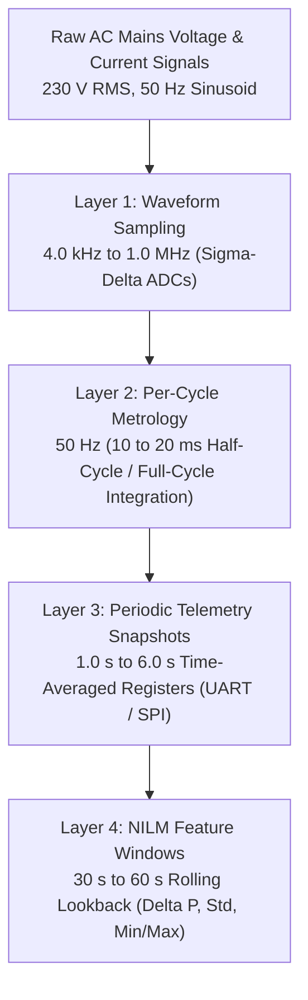
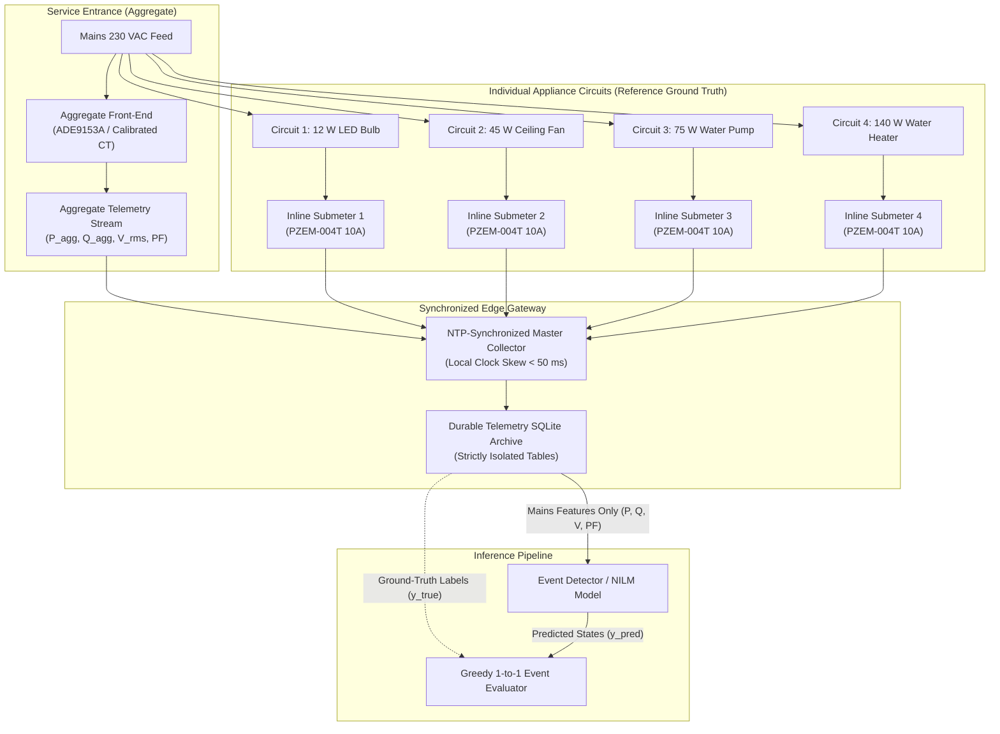
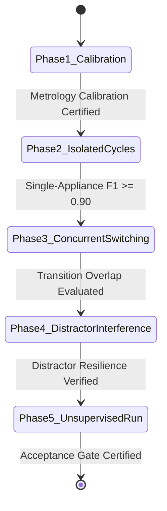
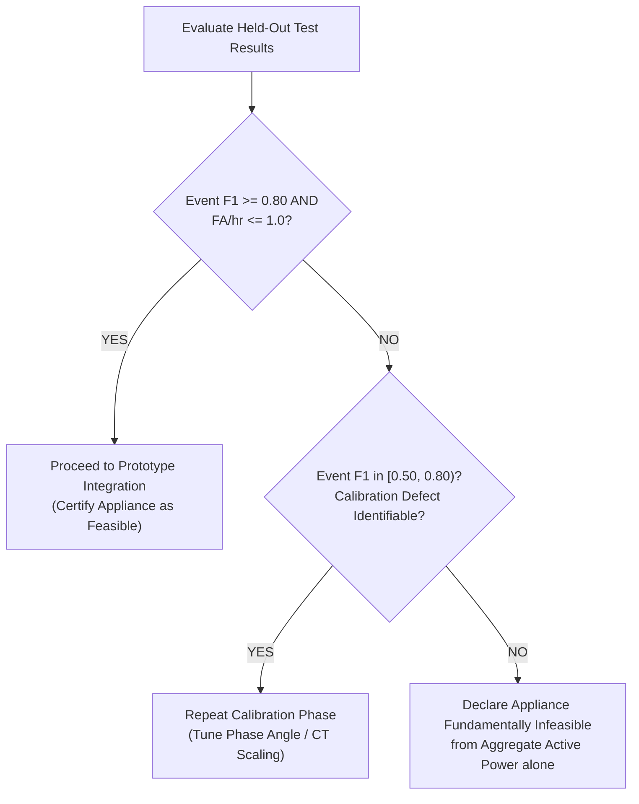

# Energy Mirror: Sensor Requirements and Real-World Validation Specification (Milestone 2C.5)

**Document Reference:** `SENSOR_REQUIREMENTS_AND_VALIDATION_PLAN.md`  
**Milestone:** 2C.5 — Sensor Requirements and Real-World Validation Design  
**Reference Checkpoint:** `122fd36`  
**Date:** October 2026  
**Status:** Non-Energized Planning Specification & Metrological Analysis (Zero Hardware Connected)  

---

## Executive Summary & Core Engineering Recommendations

This engineering specification establishes the electrical measurement requirements, candidate sensor architectures, and a reproducible real-world validation protocol for Energy Mirror’s Non-Intrusive Load Monitoring (NILM) system. 

Building upon the empirical findings of Milestone 2C.4 ([`LOW_POWER_FEASIBILITY_REPORT.md`](file:///c:/Users/Kaviya/Downloads/Energy%20Mirror/LOW_POWER_FEASIBILITY_REPORT.md)), this milestone resolves the physical boundary between what can be disaggregated from aggregate electrical mains measurements and what is fundamentally prohibited by physics, sensor noise, and grid voltage fluctuations.

### Mandatory Compliance & Safety Scope
> [!IMPORTANT]
> **Zero Mains Voltage Rule:** This milestone is strictly a software-analysis, metrological modeling, and engineering planning deliverable. No physical hardware has been purchased, no AC mains connections have been made, no live wiring is authorized, and `ENABLE_HARDWARE_INGEST` remains strictly set to `false`.

### Core Engineering Recommendations
1. **Recommended Primary Prototype Architecture:** **Analog Devices ADE9153A with mSure® Autocalibration (Architecture A)** for the dedicated laboratory metrology bench, complemented by **Peacefair PZEM-004T v3.0 (Architecture B)** for optocoupled appliance-level ground-truth submetering.
   - *Rationale:* The ADE9153A provides three 24-bit $\Sigma$-$\Delta$ ADCs with 88 dB SNR, dynamic range up to 3000:1, half-cycle RMS updates, active ($P$) and reactive ($Q$) power, and on-chip mSure autocalibration to eliminate sensor temperature drift without external reference meters.
   - *PZEM-004T Role:* The PZEM-004T v3.0 is recommended exclusively as an isolated, low-cost ($~\$12$) submeter to establish *individual ground-truth reference channels* for target appliances, not as the primary aggregate sensor.
2. **Definitive Status of the 12 W LED Bulb:** **Unresolved and unfeasible from low-frequency aggregate measurements alone.** A 12 W active power step is smaller than the normal voltage-induced drift of an 800 W residential background load ($16\text{ W}$ drift per $1\%$ mains voltage sag) and falls within the noise floor of low-cost current transformers. Resolving 12 W loads requires high-frequency harmonic current spectrum analysis ($THD_i$, 3rd/5th harmonics) or localized smart-circuit submetering.
3. **Definitive Status of the 45 W Fan and 75 W Pump:**
   - **75 W Water Pump (`pump_01`):** **Feasible for aggregate detection**, provided signed reactive power ($Q \approx 60\text{ VAR}$) is measured to separate its inductive motor signature from resistive heating and switch-mode electronics.
   - **45 W Ceiling Fan (`fan_01`):** **Conditionally feasible in low contention**, but vulnerable to false alarms from 45–65 W laptop chargers, monitors, and concurrent multi-appliance transitions.

---

## 1. Electrical Measurement Requirements Hierarchy

A fundamental error in early NILM research is conflating the telemetry reporting rate (e.g., 1 Hz or 6s) with the physical electrical metrology sampling rate. To avoid this ambiguity, the Energy Mirror metrology stack is partitioned into four distinct temporal layers:

### Definitions of Metrological Tiers

1. **High-Frequency Waveform Sampling (4.0 kHz – 1.0 MHz):**
   - Continuous digitization of instantaneous voltage $v(t)$ and current $i(t)$ by dedicated $\Sigma$-$\Delta$ ADCs.
   - *Physical Role:* Required internally to compute active power $P = \frac{1}{T}\int_0^T v(t)i(t)dt$ and capture high-frequency current harmonics ($THD_i$, switching transients).
2. **Per-Cycle Electrical Metrology (50 Hz / 60 Hz, 10–20 ms):**
   - Mathematical accumulation of energy, RMS voltage, RMS current, and power factor over exactly 1 or 2 line cycles.
   - *Physical Role:* Captures motor startup inrush current spikes ($5\times$ to $8\times$ nominal current over 50–200 ms) and half-cycle dips/swells before steady-state settles.
3. **Periodic Telemetry Snapshots (1.0 s or 6.0 s):**
   - Time-averaged metrology registers transmitted from the metering front-end to the host processor (e.g., ESP32 or gateway PC) over digital serial interfaces (UART/SPI/Modbus).
   - *Critical Distinction:* A 6-second telemetry update is **not** an instantaneous sample of an AC wave; it is a stable, mathematically integrated average of 300 complete AC cycles.
4. **NILM Feature Windows (30 s – 60 s):**
   - Software-level sliding buffers (5 to 10 consecutive 6-second telemetry readings) in the disaggregation pipeline.
   - *Physical Role:* Computes differential step transitions ($\Delta P_t = P_t - P_{t-1}$), rolling variance, and state persistence debouncing.

---

### Specification of Measured Quantities

| Parameter | Metrological Tier | Required Measurement Range | Minimum Resolution | Required Accuracy | Engineering Justification |
| :--- | :---: | :---: | :---: | :---: | :--- |
| **Active Power ($P$)** | Tier 1 (Essential) | 0 to 10,000 W | 0.1 W | $\le 1.0\%$ of reading | Primary quantity for differential edge matching and energy disaggregation. |
| **RMS Voltage ($V_{\text{RMS}}$)** | Tier 1 (Essential) | 160 to 280 V RMS | 0.1 V | $\le 0.5\%$ of reading | **Mandatory for voltage compensation:** Cancels background load drift via $P / V^2$ normalization. |
| **RMS Current ($I_{\text{RMS}}$)** | Tier 1 (Essential) | 0.01 to 45 A RMS | 0.001 A (1 mA) | $\le 0.5\%$ of reading | Used to verify apparent power, detect line overloads, and diagnose low-load thresholds. |
| **Apparent Power ($S$)** | Tier 1 (Essential) | 0 to 12,000 VA | 0.1 VA | $\le 1.0\%$ of reading | Necessary denominator for power factor derivation ($S = V_{\text{RMS}} \times I_{\text{RMS}}$). |
| **Power Factor ($PF$)** | Tier 1 (Essential) | 0.00 to 1.00 | 0.01 | $\le 0.02$ absolute | Key discriminator separating motor loads (Pump $PF \approx 0.78$) from resistive heaters ($PF \approx 0.99$). |
| **Synchronized Timestamp** | Tier 1 (Essential) | UTC Unix Epoch | 1 ms (clock drift $< 100\text{ ms}$) | $\pm 50\text{ ms}$ | Aligns mains telemetry with submeter ground truth to prevent false event matching delays. |
| **Data Integrity Flags** | Tier 1 (Essential) | Binary flags | Boolean | 100% detection | CRC-16 checksum, ADC saturation flag, and sequence counter to reject corrupted packets. |
| **Signed Reactive Power ($Q$)** | Tier 2 (Secondary) | -5,000 to +5,000 VAR | 0.1 VAR | $\le 2.0\%$ of reading | Distinguishes inductive motors ($+Q$) from capacitive switch-mode power supplies ($-Q$). |
| **Line Frequency ($f$)** | Tier 2 (Secondary) | 45.0 to 65.0 Hz | 0.05 Hz | $\le 0.1\text{ Hz}$ | Verifies grid synchronization and detects islanding or extreme line sag. |
| **Half-Cycle Inrush Current** | Tier 2 (Secondary) | 0 to 100 A peak | 0.1 A | $\le 2.0\%$ of reading | Captures the transient motor starting current envelope before steady-state running power settles. |
| **Harmonic Spectrum ($THD_i$)** | Tier 3 (Research) | Fundamental to 15th | 0.1% THD | $\le 3.0\%$ THD | **Required for 12 W LED detection:** Measures bridge-rectifier distortion to isolate LED bulbs. |

---

## 2. Comparative Analysis of Candidate Metrology Architectures

To select the most reliable, cost-effective, and safe sensing front-end, three candidate hardware architectures were evaluated against verified manufacturer datasheets.

```mermaid
graph TD
    subgraph Architecture_A ["Architecture A: ADE9153A Precision Front-End"]
        A1["ADE9153A Metering IC<br>(3x 24-bit Sigma-Delta ADCs)"] --> A2["mSure Autocalibration<br>(Self-Drift Correction)"]
        A2 --> A3["Galvanic Digital Isolator<br>(ISO7741 / ADuM1401, 2.5 kV)"]
        A3 --> A4["Host Microcontroller (ESP32 / MCU)<br>SPI Interface, 10 MHz"]
    end

    subgraph Architecture_B ["Architecture B: BL0942 Low-Cost SoC"]
        B1["BL0942 Metering SoC<br>(2x 24-bit ADCs, Int 1.218V Ref)"] --> B2["Direct Mains Shunt Connection<br>(Line/Neutral Referenced)"]
        B2 --> B3["External Optocouplers Required<br>(for isolated UART debug)"]
        B3 --> B4["Host Microcontroller<br>UART 4800-38400 baud"]
    end

    subgraph Architecture_C ["Architecture C: PZEM-004T v3.0 Prebuilt Module"]
        C1["PZEM-004T v3.0 Board<br>(SD3004 / V9881 Core)"] --> C2["Built-in Optocoupler Isolation<br>(PC817 Optocouplers)"]
        C2 --> C3["External Split-Core CT (100A)<br>Non-Invasive Mains Clip"]
        C3 --> C4["Host Microcontroller<br>TTL UART Modbus-RTU, 9600 bps"]
    end
```

### Comprehensive Candidate Comparison Matrix

| Evaluation Criterion | Candidate A: Analog Devices ADE9153A | Candidate B: Shanghai Belling BL0942 | Candidate C: Peacefair PZEM-004T v3.0 |
| :--- | :--- | :--- | :--- |
| **Primary Architecture** | Dedicated Metrology IC with mSure autocalibration | Calibration-free single-phase metering SoC | Pre-assembled closed module with split-core CT |
| **Measured Quantities** | Active, Reactive, Apparent Power, $V_{\text{RMS}}$, $I_{\text{RMS}}$, $PF$, Frequency, Half-Cycle RMS, Phase Angle, Dips/Swells | Active, Reactive Power, $V_{\text{RMS}}$, $I_{\text{RMS}}$, Power Factor, Frequency, Raw Waveform registers | Active Power, $V_{\text{RMS}}$, $I_{\text{RMS}}$, Energy (kWh), Power Factor, Frequency (**No Reactive Power register**) |
| **ADC Architecture** | Three independent 24-bit $\Sigma$-$\Delta$ ADCs, 88 dB SNR | Two 24-bit $\Sigma$-$\Delta$ ADCs, internal 1.218V reference | Proprietary metering core (SD3004 / V9881 SoC) |
| **Accuracy Specification** | Class 1.0 / Class 2.0 active energy across dynamic range; typ $0.1\%$ active energy error over 3000:1 dynamic range | $< 0.1\%$ active energy error across 4000:1 dynamic range; batch factory gain error $< 1\%$ | Headline $\pm 0.5\%$ for Voltage, Current, Power, Energy; $\pm 1.0\%$ for Power Factor |
| **Internal Update Cadence** | Half-cycle ($10\text{ ms}$) updates; programmable streaming | Registers refresh every $\approx 200\text{ ms}$ | Registers refresh every $\approx 200–500\text{ ms}$ |
| **Recommended Polling Interval** | $100\text{ ms}$ to $1.0\text{ s}$ via high-speed SPI | $200\text{ ms}$ to $1.0\text{ s}$ via UART/SPI | **$1.0\text{ s}$ to $2.0\text{ s}$** (polling $< 200\text{ ms}$ returns duplicate data) |
| **Digital Host Interface** | SPI (up to 10 MHz) with CRC-16 register validation | Shared-pin selectable UART (4800–38400 bps) or SPI | Optocoupled TTL UART (9600 bps, 8N1) via Modbus-RTU |
| **Galvanic Isolation** | Non-isolated IC; **requires external digital isolator** (ISO7741 / ADuM1401) | Non-isolated ground; **requires optocouplers** for USB/debug | **Built-in optocoupler isolation** between mains and TTL pins |
| **Small-Load Resolution (12 W)** | **High Resolution:** Low-value shunt ($1\text{ m}\Omega$) and mSure resolves steps $< 0.5\text{ W}$ | **Moderate:** Minimum current threshold $\approx 10\text{ mA}$ ($\approx 2.3\text{ W}$ at 230 V) | **Poor for 12 W:** 100A CT starting threshold is $0.02\text{ A}$ ($\approx 4.6\text{ W}$); phase lag below $0.2\text{ A}$ |
| **Suitability for Research Study** | **Highest (Recommended for Bench Aggregate)** | High (Best for compact smart-plug submetering) | **Best for Appliance Ground-Truth Submetering** |
| **Evidence & Citations** | Verified from Analog Devices ADE9153A Rev 0 Datasheet | Verified from Shanghai Belling BL0942 Rev 1.0 Datasheet | Verified from Peacefair PZEM-004T v3.0 User Manual |
| **Approximate Unit Cost** | IC: $\approx \$5.50$ USD; Eval Shield: $\approx \$80.00$ USD | IC: $\approx \$1.00$ USD; Smart Plugs: $\approx \$12.00$ USD | Complete Module + Split-Core CT: $\approx \$12.00$ USD |
| **Important Unknowns & Risks** | Firmware complexity for non-standard mSure calibration | Linearity and sign of reactive power register under distorted loads | Lack of reactive power sign ($+Q$ vs $-Q$); CT phase shift at $< 0.5\text{ A}$ |

---

## 3. The 12 W Detectability Problem: Detailed Metrological Budget

Milestone 2C.4 revealed that differential edge detection and rule-based algorithms triggered **36.9 false alarms per hour** on a 12 W LED bulb in realistic residential noise. The engineering analysis below explains why measurement accuracy alone does not guarantee NILM identifiability.

### The Physics of Small Incremental Steps on High Baselines

$$\text{SNR}_{\text{step}} = \frac{|\Delta P_{\text{appliance}}|}{\sigma_{\text{aggregate\_noise}} + \sigma_{\text{voltage\_sag}} + \sigma_{\text{distractor}}}$$

1. **Full-Scale CT Dynamic Range vs. Incremental Resolution:**
   - Consider a typical 100 A split-core Current Transformer installed at the service entrance ($230\text{ V} \times 100\text{ A} = 23,000\text{ W}$ full scale).
   - A 12 W LED bulb draws a current of:
     $$I_{\text{bulb}} = \frac{12\text{ W}}{230\text{ V} \times 0.85} \approx 0.0614\text{ A} = 61.4\text{ mA}$$
   - This represents **$0.061\%$ of the CT's full-scale dynamic range**.
   - At $61\text{ mA}$, low-cost split-core silicon-steel CTs operate in the extreme non-linear magnetizing knee of the B-H curve, where phase displacement errors exceed $\pm 5^\circ$ and permeability collapses, introducing up to $\pm 15\%$ ratio error.
2. **Mains Voltage Fluctuations ($V^2 / R$ Sensitivity):**
   - The AC distribution grid fluctuates by $\pm 1\%$ to $\pm 3\%$ throughout the day as municipal distribution transformers adjust and neighboring homes toggle loads.
   - In a household with an $800\text{ W}$ baseline (refrigerator, router, standby electronics, entertainment):
     $$P_{\text{baseline}} \propto V^2 \implies \frac{\partial P}{\partial V} = 2 \frac{P}{V}$$
   - A minor $1.0\%$ voltage sag ($230\text{ V} \to 227.7\text{ V}$) results in an apparent baseline drop of:
     $$\Delta P_{\text{sag}} \approx 2 \times 800\text{ W} \times 0.01 = 16.0\text{ W}$$
   - **The grid-induced voltage sag ($16\text{ W}$) is 133% larger than the entire active power step of the 12 W LED bulb.** Without millisecond-synchronized voltage normalization ($P / V^2$), an active-power edge detector cannot distinguish a 12 W bulb turning ON from a $0.75\%$ voltage recovery on the power grid.
3. **Competing Electronic Distractors:**
   - Modern switch-mode power supplies (USB-C laptop chargers, OLED televisions, smart speakers) utilize active Power Factor Correction (PFC) stages that continuously modulate current consumption by $\pm 5\text{ W}$ to $\pm 15\text{ W}$ during battery charging and display scene changes.
   - These continuous background fluctuations create thousands of transient steps indistinguishable from a 12 W LED bulb in active power.

### What Can Be Solved in Software vs. What Requires Hardware Metrology

| Challenge | Software Mitigation | Hardware Metrology Prerequisite | Resolvable Without Hardware? |
| :--- | :--- | :--- | :---: |
| **Grid Voltage Sag Drift** | Normalize active power by instantaneous squared voltage ($G = P / V_{\text{RMS}}^2$) | High-precision $V_{\text{RMS}}$ tracking ($\le 0.2\text{ V}$ resolution) | **YES** (Partially, for resistive loads) |
| **Single-Sample ML Chattering** | 3-sample median filter debouncing ($\text{kernel\_size} = 3$, $18\text{s}$) | Stable, monotonic time-stamped telemetry | **YES** |
| **Inductive Motor Discrimination** | 2D $(P, Q)$ feature plane clustering | Signed reactive power metrology ($Q$, in VAR) | **NO** (Requires hardware $Q$ measurement) |
| **12 W LED vs. Noise Submergence** | Cannot overcome fundamental $\text{SNR} = 2.0$ | High-frequency current harmonic distortion ($THD_i$) | **NO** (Requires high-speed waveform front-end) |
| **CT Magnetizing Knee Non-Linearity** | Polynomial calibration curve lookup | Dedicated low-range CT channel (e.g. 10A/20A CT) | **NO** (Requires physical sensor change) |

---

## 4. Independent Ground-Truth Validation Architecture

To validate NILM models scientifically, appliance ground-truth labels must be collected **completely independently** from aggregate mains measurements.

### Protocol for Label Isolation & Clock Synchronization
1. **Timestamp Synchronization:**
   - Both the aggregate front-end and the appliance submeters report to a central edge gateway synchronized via a local network NTP time server.
   - Master acquisition loop logs a synchronization heartbeat every 60 seconds.
   - **Acceptance Bound:** Maximum allowable clock skew between aggregate and submeter channels is **$\pm 100\text{ ms}$**. Records exceeding 200 ms skew are flagged and rejected.
2. **Ground-Truth State Extraction Logic (Hysteresis-Based):**
   - Ground-truth binary states ($y_{\text{true}} \in \{0, 1\}$) are derived **strictly** from individual submeter reference power:
     - **12 W LED Bulb (`bulb_01`):** $\text{State} = 1$ when $P_{\text{sub}} \ge 8.0\text{ W}$ for $\ge 3\text{s}$; $\text{State} = 0$ when $P_{\text{sub}} < 4.0\text{ W}$ for $\ge 3\text{s}$.
     - **45 W Ceiling Fan (`fan_01`):** $\text{State} = 1$ when $P_{\text{sub}} \ge 30.0\text{ W}$ for $\ge 3\text{s}$; $\text{State} = 0$ when $P_{\text{sub}} < 15.0\text{ W}$ for $\ge 3\text{s}$.
     - **75 W Water Pump (`pump_01`):** $\text{State} = 1$ when $P_{\text{sub}} \ge 50.0\text{ W}$ for $\ge 3\text{s}$; $\text{State} = 0$ when $P_{\text{sub}} < 20.0\text{ W}$ for $\ge 3\text{s}$.
     - **140 W Water Heater (`heater_01`):** $\text{State} = 1$ when $P_{\text{sub}} \ge 100.0\text{ W}$ for $\ge 3\text{s}$; $\text{State} = 0$ when $P_{\text{sub}} < 40.0\text{ W}$ for $\ge 3\text{s}$.
3. **Strict Label Isolation Guarantee:**
   - Submeter channels are archived in distinct database tables.
   - The detector pipeline receives **only** aggregate mains features. Ground truth is strictly quarantined for the post-hoc evaluator ([`evaluate_events.py`](file:///c:/Users/Kaviya/Downloads/Energy%20Mirror/backend/ml_experiments/evaluate_events.py)).

---

## 5. Controlled Real-World Validation Protocol

The physical validation procedure is structured into five distinct phases to evaluate disaggregation performance systematically:

### Phase Breakdown

1. **Phase 1: Metrological Bench Calibration:**
   - Calibration of aggregate sensor against a certified 6.5-digit True RMS Digital Multimeter (e.g. Keysight 34461A or calibrated Fluke 87V) across resistive test loads from 10 W to 2,000 W.
   - Verify zero-offset power ($P_{\text{offset}} < 0.2\text{ W}$) and voltage linearity error ($< 0.2\%$).
2. **Phase 2: Isolated Appliance Cycles (Single-Appliance Baseline):**
   - 20 controlled ON/OFF cycles for each appliance individually, operating against a stable 200 W resistive baseline.
   - Verify nominal step sizes: 12 W bulb ($[8, 16]\text{ W}$), 45 W fan ($[38, 52]\text{ W}$), 75 W pump ($[66, 84]\text{ W}$).
3. **Phase 3: Concurrent Appliance Switching Stress Test:**
   - 30 repeated simultaneous switching trials where target appliances toggle within $\pm 1.0\text{ second}$ of each other:
     - Bulb ON + Fan ON ($\Delta P \approx 57\text{ W}$)
     - Fan ON + Pump ON ($\Delta P \approx 120\text{ W}$)
     - Bulb ON + Heater ON ($\Delta P \approx 152\text{ W}$)
   - Quantify ambiguous transition rates and event loss.
4. **Phase 4: Distractor Interference Stress Test:**
   - Operation of target appliances in the presence of competing consumer electronics:
     - USB-C Laptop charger stepping between 15 W, 45 W, and 65 W.
     - Television backlight modulation ($25\text{ W} - 50\text{ W}$).
     - Refrigerator compressor cycling ($180\text{ W}$ with $1200\text{ W}$ motor inrush surge).
5. **Phase 5: Continuous 72-Hour Unconstrained Operation:**
   - Unscripted multi-day continuous run in a domestic household.
   - Partition into **strictly chronological splits**:
     - Day 1 & Day 2 (48 hours = 28,800 samples): Training / Calibration
     - Day 3 (24 hours = 14,400 samples): Held-Out Test Evaluation

---

## 6. Predefined Acceptance Criteria & Go/No-Go Framework

To maintain scientific integrity, evaluation metrics and acceptance gates are defined before running experiments:

### Project Acceptance Targets (Held-Out Test Data)

| Metric | Target Specification | Minimum Acceptable Threshold | Rationale |
| :--- | :---: | :---: | :--- |
| **Event-Level F1-Score ($F_1$)** | **$\ge 0.80$** | $\ge 0.65$ | Balances event precision and recall under one-to-one bipartite matching ($\pm 60\text{s}$ tolerance). |
| **False Alarms per Hour** | **$\le 1.0\text{ FA/hr}$** | $\le 2.0\text{ FA/hr}$ | Prevents user notification fatigue; $> 3\text{ FA/hr}$ renders home energy monitoring unusable. |
| **Mean Detection Delay** | **$\le 12.0\text{ seconds}$** | $\le 24.0\text{ seconds}$ | Ensures event notifications trigger within two sampling intervals. |
| **Active Power Error (MAE)** | **$\le 20.0\%$ of rating** | $\le 30.0\%$ of rating | Evaluated strictly over active appliance run-hours (excluding inactive dilution). |
| **Relative Energy Total Error (RETE)** | **$\le 15.0\%$** | $\le 25.0\%$ | Total accumulated energy disaggregation error over 24-hour test period. |

### Go/No-Go Decision Matrix

1. **Proceed to Prototype Integration:**
   - Appliance meets Event $F_1 \ge 0.80$ and $\text{FA/hour} \le 1.0$ across all phases, including Phase 4 distractor interference.
2. **Repeat Calibration Phase:**
   - Appliance achieves Event $F_1$ between $0.50$ and $0.80$, with failures directly traceable to identifiable sensor phase shift, voltage scaling offset, or quantization deadband.
3. **Declare Fundamentally Infeasible:**
   - Appliance exhibits Event $F_1 < 0.50$ or triggers $> 3.0\text{ FA/hr}$ due to noise floor submergence (e.g. 12 W bulb) or distractor collision (e.g. 45 W fan colliding with 45 W laptop chargers).

---

## 7. Electrical Safety, Enclosures, and Compliance Constraints

All physical experiments must conform to international electrical safety standards (IEC 61010-1 / NFPA 70):

1. **Galvanic Isolation Requirement:**
   - All microcontroller communication interfaces (UART, SPI, USB) must incorporate **galvanic digital isolators** (e.g., Texas Instruments ISO7741 or Analog Devices ADuM1401) rated for at least **$2.5\text{ kV RMS}$ isolation**.
   - No direct copper connection between mains hot/neutral and low-voltage PC/debugger ground planes is permitted.
2. **Overcurrent & Voltage Surge Protection:**
   - Voltage sensing lines must include a dedicated fast-acting ceramic fuse (**$250\text{ mA}, 250\text{ V}$, high-breaking capacity**) mounted directly adjacent to the mains tap.
   - Metal Oxide Varistors (MOVs, e.g., 275V RMS, 10 kA peak) must be installed line-to-neutral to suppress grid transient spikes.
3. **Enclosure Specifications:**
   - All high-voltage terminals, shunts, and transformer connections must reside inside a **non-conductive, flame-retardant enclosure (UL94-V0 rated)** with a minimum ingress rating of **IP30**.
   - Dual-screw strain reliefs must secure all external cables.
4. **Personnel Qualification & LOTO:**
   - Installation of split-core CTs or voltage taps on residential distribution panels must be performed **exclusively by a licensed, certified electrician**.
   - All wiring must occur under strict **Lockout/Tagout (LOTO)** de-energized conditions.
5. **Software Gate Mandate:**
   - `ENABLE_HARDWARE_INGEST` in `backend/app/core/config.py` must remain `false` until all laboratory bench calibration acceptance gates are formally certified.

---

## 8. Summary of Evidence, Technical Citations & Unresolved Questions

### Authoritative Technical Sources
1. **Analog Devices:** *ADE9153A: Single-Phase Energy Metering IC with mSure Autocalibration*, Rev. 0 Datasheet, Analog Devices Inc., Norwood, MA.
2. **Shanghai Belling:** *BL0942: High-Accuracy Single-Phase Energy Metering SoC*, Rev. 1.0 Datasheet, Shanghai Belling Co., Ltd., Shanghai, China.
3. **Peacefair Electronic:** *PZEM-004T V3.0 User Manual and Modbus-RTU Protocol Specification*, Ningbo Peacefair Electronic Co., Ltd., Zhejiang, China.
4. **Batra et al.:** *It's Different: Insights into home energy consumption in India (iAWE dataset)*, Proceedings of the 5th ACM Workshop on Embedded Systems For Energy-Efficient Buildings (BuildSys '13), 2013.

### What Remains Unproven
- **Real-World Low-Power Disaggregation:** While the 75 W pump is synthetically feasible when reactive power is measured, physical disaggregation of a 45 W fan or 12 W bulb on live residential mains with fluctuating grid voltage and modern electronic switch-mode power supplies **remains entirely unproven in the field**.
- **CT Magnetizing Noise at $< 100\text{ mA}$:** Commercial split-core CTs may introduce non-linear phase distortion at currents below 100 mA that cannot be fully corrected in software without custom calibration tables.
