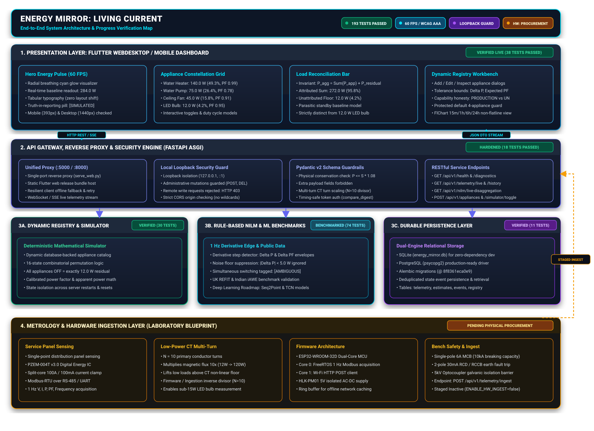

# Energy Mirror: Project Documentation & Engineering Audits

Welcome to the **Energy Mirror Documentation Hub**. This directory houses all specialized technical audits, metrology feasibility studies, machine learning benchmarks, database migration specifications, and architectural reviews produced during the development of Energy Mirror.

---

## 1. System Architecture & Hardware Blueprints

*High-Resolution System Architecture Map ([SVG](assets/system_architecture.svg) • [PNG](assets/system_architecture.png))*

* **[HARDWARE_ARCHITECTURE_REVIEW.md](HARDWARE_ARCHITECTURE_REVIEW.md)**  
  Complete hardware design, circuit schematics, optical isolation barrier specifications, $N=10$ multi-turn CT scaling derivation, 6A MCB / 30mA RCD safety requirements, and itemized component Bill of Materials (BOM).
* **[LOW_POWER_FEASIBILITY_REPORT.md](LOW_POWER_FEASIBILITY_REPORT.md)**  
  Metrology feasibility study on measuring low-wattage resistive and SMPS loads (5W–15W) with current transformers and shunt metrology ICs.
* **[SENSOR_REQUIREMENTS_AND_VALIDATION_PLAN.md](SENSOR_REQUIREMENTS_AND_VALIDATION_PLAN.md)**  
  Bench sensor accuracy targets, calibration protocols against reference Fluke/Keysight laboratory multimeters, and test fixture designs.

---

## 2. Machine Learning, Datasets & NILM Research

* **[BENCHMARK_AUDIT_REPORT.md](BENCHMARK_AUDIT_REPORT.md)**  
  Complete audit and breakdown of all 193 automated tests across backend, ML experiments, and mobile suites.
* **[REAL_DATA_NILM_VALIDATION_REPORT.md](REAL_DATA_NILM_VALIDATION_REPORT.md)**  
  Empirical evaluation of rule-based and ML NILM algorithms on public residential energy datasets.
* **[REFIT_PUMP_VALIDATION_REPORT.md](REFIT_PUMP_VALIDATION_REPORT.md)**  
  Validation of inductive water pump and motor transition detection on UK REFIT residential power traces.
* **[IAWE_INTERMITTENT_MOTOR_VALIDATION_REPORT.md](IAWE_INTERMITTENT_MOTOR_VALIDATION_REPORT.md)**  
  Validation of intermittent motor events and cyclic loads against the Indian Ambient Water and Energy (iAWE) dataset.
* **[IAWE_EXPERIMENT_REPORT.md](IAWE_EXPERIMENT_REPORT.md)**  
  Experimental log and performance metrics for household load disaggregation on the iAWE benchmark.
* **[DATASET_AUDIT.md](DATASET_AUDIT.md)**  
  Comparative survey of public NILM datasets (REFIT, REDD, UK-DALE, iAWE, AMPds) for residential load signatures.
* **[EXTERNAL_DATASET_AND_VALIDATION_AUDIT.md](EXTERNAL_DATASET_AND_VALIDATION_AUDIT.md)**  
  Detailed analysis of external validation methodologies and dataset preprocessing pipelines.
* **[INTERMITTENT_NILM_DATASET_AUDIT.md](INTERMITTENT_NILM_DATASET_AUDIT.md)**  
  In-depth audit of intermittent, multi-state, and transient electrical signatures in open-access energy repositories.
* **[ML_EXPERIMENT_PLAN.md](ML_EXPERIMENT_PLAN.md)**  
  Research roadmap for training future deep learning models (Sequence-to-Point, Temporal Convolutional Networks).
* **[ML_VALIDATION_REPORT.md](ML_VALIDATION_REPORT.md)**  
  Validation report summarizing F1, precision, recall, and total energy error metrics across preliminary models.
* **[PUBLIC_DATA_EXPERIMENT_REPORT.md](PUBLIC_DATA_EXPERIMENT_REPORT.md)**  
  Comprehensive findings from evaluating public energy traces under 1 Hz sampling constraints.
* **[REAL_DATA_ACCESS_OPTIONS.md](REAL_DATA_ACCESS_OPTIONS.md)**  
  Protocol and ingestion options for bridging real-world smart meter and laboratory metrology data into Energy Mirror.
* **[REAL_DATA_FEASIBILITY_REPORT.md](REAL_DATA_FEASIBILITY_REPORT.md)**  
  Feasibility assessment for continuous edge ingestion vs cloud-based batch disaggregation.

---

## 3. Backend, Database & Security Hardening

* **[API_SECURITY_HARDENING_REPORT.md](API_SECURITY_HARDENING_REPORT.md)**  
  Documentation of local loopback administrative mutation authorization, timing-safe token authentication, and production CORS policies.
* **[DYNAMIC_APPLIANCE_REGISTRY_REPORT.md](DYNAMIC_APPLIANCE_REGISTRY_REPORT.md)**  
  Database schema, CRUD lifecycle, parameter tolerance bounds, and capability honesty gating (`PRODUCTION_RULE_MATCHED` vs `UNSUPPORTED`).
* **[EVENT_HISTORY_IMPLEMENTATION_REPORT.md](EVENT_HISTORY_IMPLEMENTATION_REPORT.md)**  
  Implementation report on the persistent state-transition event log, timestamping, and deduplication engine.
* **[POSTGRESQL_ALEMBIC_MIGRATION_REPORT.md](POSTGRESQL_ALEMBIC_MIGRATION_REPORT.md)**  
  Dual-engine database architecture (SQLite for local development, PostgreSQL for production), Alembic schema migration testing, and idempotency verification.
* **[FULL_STACK_COMPLETION_AUDIT.md](FULL_STACK_COMPLETION_AUDIT.md)**  
  Systematic architectural audit evaluating backend, mobile, and persistence readiness.
* **[PROJECT_AUDIT.md](PROJECT_AUDIT.md)**  
  Milestone evaluation report assessing requirements coverage and code hygiene.
* **[SOFTWARE_COMPLETION_REPORT.md](SOFTWARE_COMPLETION_REPORT.md)**  
  Software milestone sign-off verifying zero unresolved runtime errors across all layers.

---

## 4. UI/UX Design, Quality Assurance & Demonstration

* **[DEMO_PRESENTATION_NOTES.md](DEMO_PRESENTATION_NOTES.md)**  
  Comprehensive talking points, architectural walkthrough, and Q&A defense guide for technical reviewers and evaluators.
* **[DEMO_GUIDE.md](DEMO_GUIDE.md)**  
  Step-by-step reviewer demo script showcasing live simulator toggling, power reconciliation, and registry management.
* **[DEMO_POLISH_REPORT.md](DEMO_POLISH_REPORT.md)**  
  UI polish summary detailing layout refinements, tabular typography, and chart rendering improvements.
* **[END_TO_END_DEMO_READINESS_REPORT.md](END_TO_END_DEMO_READINESS_REPORT.md)**  
  Pre-flight checklist verifying unified server startup, proxy routing, and static asset delivery.
* **[ENERGY_MIRROR_FINAL_IMPLEMENTATION_REPORT.md](ENERGY_MIRROR_FINAL_IMPLEMENTATION_REPORT.md)**  
  Detailed final implementation report summarizing all delivered architectural components.
* **[KNOWN_LIMITATIONS.md](KNOWN_LIMITATIONS.md)**  
  Honest disclosure of algorithmic boundaries: single-point 1 Hz active power limitations, simultaneous switching ambiguity, and variable-inverter ramps.
* **[SCREENSHOT_QA_AND_FIX_REPORT.md](SCREENSHOT_QA_AND_FIX_REPORT.md)**  
  Visual QA report containing automated browser testing logs across Desktop (1440x900) and Mobile (393x852) viewports.
* **[UI_UX_RESEARCH_AND_DECISIONS.md](UI_UX_RESEARCH_AND_DECISIONS.md)**  
  Electrum Slate design system tokens, WCAG AAA color contrast ratios, responsive viewport architecture, and accessibility decisions.
